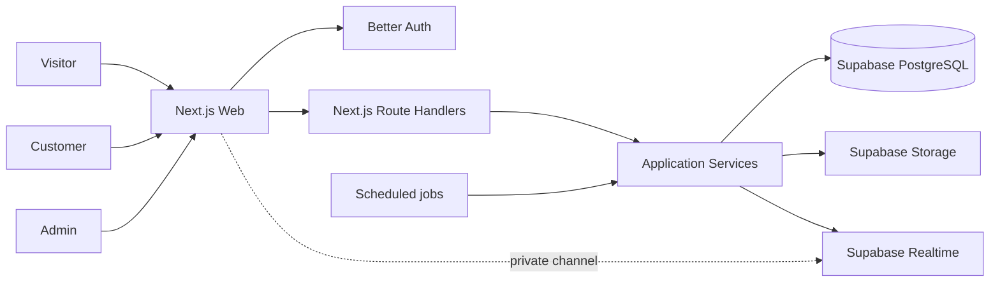
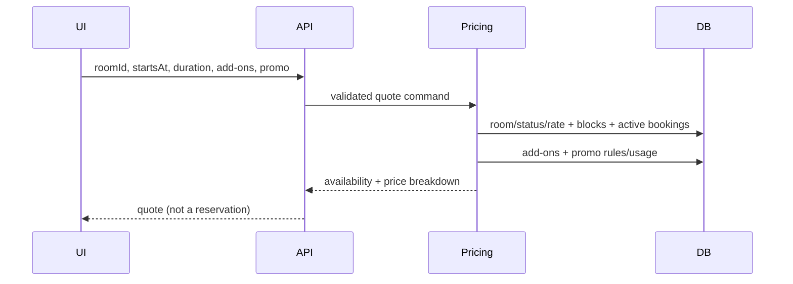
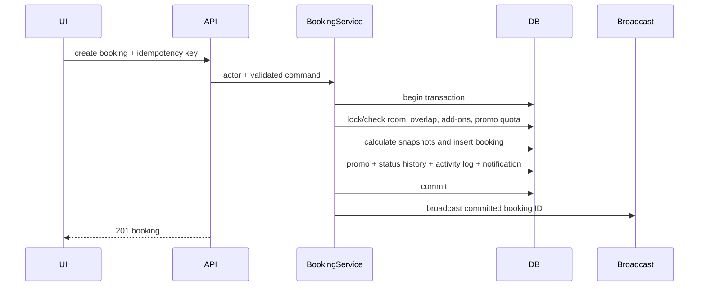
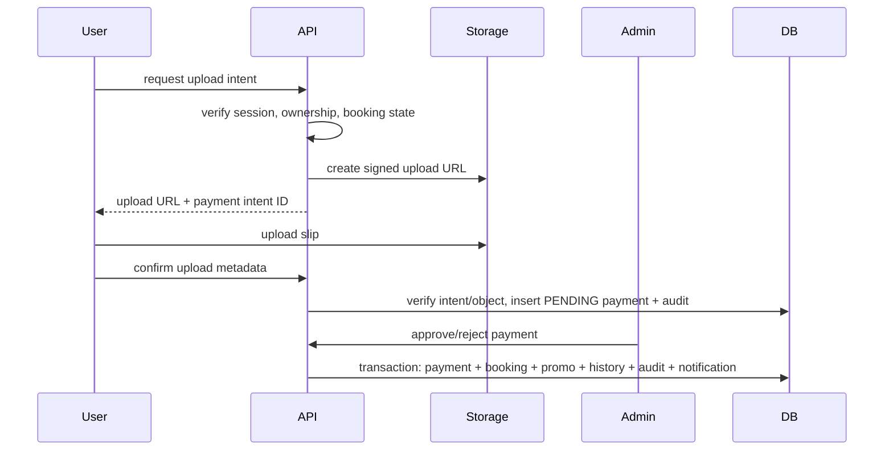
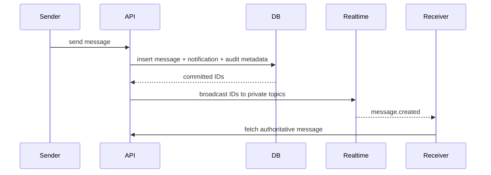

# System Architecture

## 1. Overview

SMT Studio ใช้สถาปัตยกรรม **Next.js Modular Monolith**: deploy เป็นแอปเดียวและใช้ repository เดียว แต่แยก Frontend, HTTP API, application/domain logic, data access และ external integrations เป็น boundary ที่ตรวจสอบได้

เหตุผลที่เลือกแนวทางนี้:

- เหมาะกับทีมและขอบเขตปัจจุบันมากกว่า microservices
- Transaction สำคัญ เช่น Booking + Promo reservation + Audit ทำใน PostgreSQL เดียวได้
- Frontend และ API ใช้ TypeScript contract ร่วมกันโดยไม่แชร์ database entity
- สามารถแยก service ออกภายหลังได้เมื่อมีหลักฐานด้าน scale/ownership ที่ชัดเจน

## 2. Architecture Principles

1. **Database is authoritative:** PostgreSQL เป็นความจริงสุดท้าย Realtime และ cache สร้างใหม่ได้
2. **Server owns business rules:** Client ส่ง intent ไม่ส่งผลคำนวณที่เชื่อถือได้
3. **Default-deny security:** ทุก protected operation ตรวจ session, role และ ownership ฝั่ง server
4. **Explicit boundaries:** UI ไม่ query database; Route Handler ไม่เก็บ business logic; repository ไม่รู้จัก React
5. **Defense in depth:** Service validation + transaction + database constraint
6. **Immutable history:** Booking snapshots, status history และ Activity Log รักษาอดีต
7. **Graceful degradation:** Chat/Notification ยังใช้งานผ่าน refetch/polling เมื่อ Realtime ขัดข้อง
8. **YAGNI:** MVP ไม่มี EasySlip, payment gateway, microservices, mobile app หรือ attachment ใน Chat

## 3. System Context



Supabase Auth ไม่อยู่ในระบบ Better Auth เป็นผู้จัดการ identity/session และระบบออก short-lived JWT สำหรับ Realtime โดยใช้ signing key ที่ Supabase trust เท่านั้น

## 4. Layer Boundaries

```mermaid
flowchart TB
    subgraph Frontend
      Pages[Routes and layouts]
      UI[Components]
      Features[Forms, hooks, API clients]
    end

    subgraph Transport
      AuthRoutes[/api/auth/*]
      BusinessRoutes[/api/v1/*]
    end

    subgraph Server
      Authz[Session and authorization]
      Modules[Application/domain modules]
      Repositories[Repositories]
      Integrations[Storage and Realtime adapters]
    end

    Pages --> Features
    Features --> BusinessRoutes
    AuthRoutes --> Authz
    BusinessRoutes --> Authz
    Authz --> Modules
    Modules --> Repositories
    Modules --> Integrations
```

### Allowed dependency direction

```text
UI / Route Handler
        ↓
Application service
        ↓
Domain policy
        ↓
Repository / Integration port
        ↓
Drizzle / Supabase SDK
```

- Domain/application codeห้าม import จาก `app/`, `components/` หรือ `features/`
- Client code ห้าม import จาก `server/` หรือ `db/`
- Route Handler import service ได้ แต่ service ห้าม import Route Handler
- API DTO/schema แยกจาก Drizzle row; response ไม่ expose internal columns โดยอัตโนมัติ

## 5. Target Repository Structure

```text
app/
├── (public)/
│   ├── page.tsx
│   └── rooms/
├── (customer)/
│   ├── booking/new/
│   ├── bookings/
│   ├── profile/
│   ├── chat/
│   └── notifications/
├── admin/
│   ├── page.tsx
│   ├── calendar/
│   ├── bookings/
│   ├── rooms/
│   ├── equipment/
│   ├── add-ons/
│   ├── discounts/
│   ├── payments/
│   ├── users/
│   ├── chat/
│   ├── reports/
│   ├── activity-logs/
│   └── settings/
└── api/
    ├── auth/[...all]/route.ts
    └── v1/

components/
├── ui/
├── public/
├── customer/
└── admin/

features/
├── auth/
├── rooms/
├── bookings/
├── discounts/
├── payments/
├── chat/
├── notifications/
└── admin/

server/
├── auth/
│   ├── auth.ts
│   ├── permissions.ts
│   └── session.ts
├── modules/
│   ├── users/
│   ├── rooms/
│   ├── bookings/
│   ├── pricing/
│   ├── discounts/
│   ├── payments/
│   ├── chat/
│   ├── notifications/
│   ├── reports/
│   └── activity-logs/
├── repositories/
├── integrations/
│   ├── storage/
│   └── realtime/
├── jobs/
└── shared/

db/
├── client.ts
├── schema/
├── migrations/
└── seed/

contracts/
├── api/
└── events/

tests/
├── integration/
├── e2e/
└── fixtures/
```

ชื่อไฟล์จริงอาจแตกย่อยตาม use case แต่ boundary ด้านบนต้องคงอยู่

## 6. Frontend Architecture

Frontend แบ่งเป็นสามผลิตภัณฑ์ภายใน shell เดียวกัน

### 6.1 Public/Landing

Routes:

- `/` — Brand, ห้องแนะนำ, services และ call to action
- `/rooms` — Room list/filter
- `/rooms/[slug]` — Room detail, equipment, images และ availability
- `/login`, `/register` — Better Auth forms

หลักการ:

- ใช้ Server Components สำหรับ content/read-heavy UI เป็นค่าเริ่มต้น
- ห้องที่เผยแพร่และข้อมูลคงที่สามารถ cache/revalidate ได้
- Availability เป็น dynamic และต้องไม่ cache ข้ามช่วง/ผู้ใช้โดยผิดพลาด
- ใช้ asset ใน `public/logo` และ `public/picture` หลังตรวจลิขสิทธิ์ ชื่อไฟล์ และ alt text

### 6.2 Customer Portal

Routes:

- `/booking/new` — เลือกห้อง เวลา Add-on Promo และดู quote
- `/bookings` — ประวัติ/ตัวกรอง
- `/bookings/[id]` — รายละเอียด status history, payment และ cancellation
- `/profile` — ข้อมูลส่วนตัว
- `/chat` — Support conversation
- `/notifications` — รายการแจ้งเตือน

UI state ชั่วคราว เช่น booking form อยู่ใน feature layer แต่ quote/availability ต้องขอใหม่จาก server ก่อนสร้าง Booking

### 6.3 Admin Portal

Routes:

- `/admin` — Dashboard
- `/admin/calendar` — Booking calendar + Room Blocks
- `/admin/bookings`, `/admin/payments` — Operations queue
- `/admin/rooms`, `/admin/equipment`, `/admin/add-ons`, `/admin/discounts` — Catalog management
- `/admin/users`, `/admin/chat` — Customer support
- `/admin/reports`, `/admin/activity-logs`, `/admin/settings` — Reporting/governance

Admin layout ตรวจ session เพื่อ redirect ทาง UX แต่ API/service ยังคงตรวจ role ทุก request

### 6.4 Data Access from UI

- Client Components ใช้ typed API client เรียก `/api/v1/*`
- Server Components เรียก server-only application query โดยตรง ไม่ fetch API ของแอปตัวเอง เพราะ Next.js ระบุว่าจะเพิ่ม HTTP round trip และ build-time route อาจไม่มี server ให้เรียก
- ทั้งสองเส้นทางใช้ authorization policy, DTO mapping และ repository ชุดเดียวกัน
- Mutation ธุรกิจใช้ Route Handlers เพื่อให้ contract ชัด รองรับ idempotency และทดสอบจากภายนอกได้
- Better Auth client เรียก `/api/auth/*` ตาม integration ของ library

## 7. API Architecture

### 7.1 Route Handler Responsibilities

Route Handler ทำตามลำดับ:

1. สร้าง/อ่าน `requestId`
2. Parse URL/body และ enforce payload limit
3. อ่าน Better Auth session
4. ตรวจ role/ownership เบื้องต้น
5. Validate ด้วย request schema
6. เรียก application service หนึ่ง use case
7. Map result เป็น public DTO และ HTTP status
8. Map expected domain error เป็น stable error code
9. Log unexpected error โดยไม่เปิดเผย secret/stack แก่ Client

### 7.2 Public API

| Method | Path | หน้าที่ |
| --- | --- | --- |
| `GET` | `/api/v1/rooms` | ห้องที่เผยแพร่ พร้อม pagination/filter |
| `GET` | `/api/v1/rooms/:slug` | รายละเอียดห้อง รูปและอุปกรณ์ |
| `GET` | `/api/v1/rooms/:id/availability` | ช่วงว่างใน `from`–`to` |
| `POST` | `/api/v1/booking-quotes` | คำนวณ quote แบบไม่สร้าง Booking |

### 7.3 Customer API

| Method | Path | หน้าที่ |
| --- | --- | --- |
| `GET/PATCH` | `/api/v1/me/profile` | อ่าน/แก้ Profile |
| `GET/POST` | `/api/v1/me/bookings` | ประวัติ/สร้าง Booking |
| `GET` | `/api/v1/me/bookings/:id` | Booking detail ของตน |
| `POST` | `/api/v1/me/bookings/:id/cancel` | ยกเลิกตาม cutoff |
| `POST` | `/api/v1/me/bookings/:id/payment-upload` | ออก signed upload URL และสร้าง upload intent |
| `POST` | `/api/v1/me/bookings/:id/payments` | ยืนยัน upload และสร้าง Payment attempt |
| `GET` | `/api/v1/me/conversation` | เปิด/สร้าง Support Conversation |
| `GET/POST` | `/api/v1/me/conversation/messages` | อ่าน/ส่ง Chat |
| `POST` | `/api/v1/me/conversation/read` | ขยับ read cursor |
| `GET` | `/api/v1/me/notifications` | รายการ Notification |
| `POST` | `/api/v1/me/notifications/read` | Mark one/all read |
| `POST` | `/api/v1/me/realtime-token` | ออก short-lived JWT หลังตรวจ session |

### 7.4 Admin API

| Area | Paths โดยย่อ |
| --- | --- |
| Dashboard | `GET /api/v1/admin/dashboard` |
| Rooms | CRUD/archive `/admin/rooms`, images, blocks และ status |
| Equipment | CRUD/archive `/admin/equipment`; assign ผ่าน `/admin/rooms/:id/equipment` |
| Add-ons | CRUD/archive `/admin/add-ons` |
| Discounts | CRUD/archive/activate `/admin/promo-codes` และ room scope |
| Bookings | `GET /admin/bookings`, detail, status transition และ cancellation |
| Calendar | `GET /admin/calendar?from=&to=&roomId=` |
| Payments | Queue/detail, signed slip URL, approve, reject และ refund |
| Users | `GET /admin/users` และ `GET /admin/users/:id` |
| Chat | Conversation list/messages/send/read/close |
| Reports | `/admin/reports/revenue`, `/admin/reports/bookings` |
| Audit | `GET /admin/activity-logs` และ detail; ไม่มี mutation endpoint |
| Settings | `GET/PATCH /admin/settings/booking` |

Endpoint จริงต้องมี contract test ก่อนถือว่า stable การเปลี่ยนชื่อ/shape แบบ breaking ต้อง version API

### 7.5 API Response Contract

Success:

```json
{
  "data": {},
  "meta": {
    "requestId": "019...",
    "pagination": {
      "cursor": "...",
      "hasMore": false
    }
  }
}
```

Error:

```json
{
  "error": {
    "code": "BOOKING_CONFLICT",
    "message": "ช่วงเวลานี้ไม่ว่างแล้ว",
    "fieldErrors": {
      "startsAt": ["กรุณาเลือกช่วงเวลาใหม่"]
    },
    "requestId": "019..."
  }
}
```

`message` เหมาะกับการแสดงผลได้ แต่ Frontend ควร map จาก `code` เพื่อควบคุมภาษาอย่างสม่ำเสมอ

## 8. Authentication and Authorization

### 8.1 Better Auth

- Mount `toNextJsHandler(auth)` ที่ `/api/auth/[...all]`
- ใช้ Drizzle adapter provider `pg`
- เปิด email/password และ Admin plugin
- Better Auth ดูแลตาราง `user`, `session`, `account`, `verification`
- `user_profiles` เก็บชื่อ/นามสกุล/เบอร์โทรเชิงธุรกิจแบบ one-to-one; display name ใน Better Auth ต้อง sync ผ่าน application service
- role มาตรฐานคือ `user` และ `admin`
- Session cookie ใช้ค่าความปลอดภัยที่ Better Auth แนะนำสำหรับ production origin

### 8.2 Authorization Matrix

| Resource | Visitor | User | Admin |
| --- | --- | --- | --- |
| Published room/availability | Read | Read | Read/write all |
| Own profile | — | Read/write own | Read all |
| Booking | — | Create/read/cancel own | Read/transition all |
| Payment slip | — | Upload own; metadata own | Review/download all |
| Promo definition | — | Validate by code only | CRUD/report |
| Conversation/message | — | Own conversation | All conversations |
| Notification | — | Own only | Own admin notifications |
| Reports | — | — | Read |
| Activity Log | — | — | Read only |
| System settings | — | — | Read/write |

Resource ownership ต้องตรวจใน query/service ไม่รับ `userId` จาก Client เพื่อกำหนดเจ้าของ

### 8.3 Navigation Guard

Next.js 16 เปลี่ยน convention จาก `middleware.ts` เป็น `proxy.ts` ระบบอาจใช้ `proxy.ts` เพื่อ redirect ผู้ไม่มี session จาก `/admin` หรือ customer pages แต่ guard นี้ไม่ทดแทน authorization ใน Route Handler/service

## 9. Domain Modules

| Module | Use cases หลัก | Dependencies |
| --- | --- | --- |
| Users | Get/update profile, admin list users | Better Auth, user repository, audit |
| Rooms | List/detail, CRUD, status, images, equipment, blocks | room repository, Storage, audit |
| Pricing | Quote room/add-ons/discount | room, add-on, discount policies |
| Bookings | Availability, create, cancel, expire, transition, calendar | pricing, promo, booking repo, notification, audit |
| Discounts | Validate, reserve, apply, release, CRUD | promo repository, booking transaction, audit |
| Payments | Upload intent, submit, approve/reject, refund | Storage, booking, notification, audit |
| Chat | Conversation, messages, read cursor | chat repo, Realtime, notification |
| Notifications | Persist, list, mark read, broadcast | notification repo, Realtime |
| Reports | Dashboard, revenue, booking statistics | read-only reporting queries |
| Activity Logs | Append and search audit records | audit repository |

Service หนึ่ง use case รับ actor context + validated command/query และคืน domain result ไม่รับ `Request`/`Response` object

## 10. Critical Data Flows

### 10.1 Availability and Quote



Quote มีอายุเชิงข้อมูลสั้นและไม่ lock ห้อง การสร้าง Booking ต้องคำนวณใหม่

### 10.2 Booking Creation



ถ้า exclusion constraint ชน ให้ rollback และตอบ `409 BOOKING_CONFLICT`

ยอดสุทธิมากกว่า 0 สร้างเป็น `PENDING_PAYMENT` ส่วนยอดสุทธิ 0 สร้างเป็น `CONFIRMED`, Apply Promo ทันที และไม่สร้าง Payment

### 10.3 Payment Submission and Review



Approval เป็น transaction เดียว: Payment `PAID`, Booking `CONFIRMED`, Promo `APPLIED` ส่วน Booking ยอดสุทธิ 0 Confirm ทันทีโดยไม่มี Payment

### 10.4 Cancellation and Refund

1. Service โหลด Booking ด้วย row lock
2. User request ตรวจ ownership และ `now <= startsAt - 12h`; Admin override ต้องมีเหตุผล
3. เปลี่ยน Booking เป็น `CANCELLED` และเพิ่ม status history
4. ถ้าไม่มี Payment ปล่อย Promo `RESERVED -> RELEASED`
5. ถ้ามี Payment `PENDING` ให้ release Promo reservation และคง Payment ไว้ตรวจ; สลิปที่ถูกต้องเข้าสู่ `REFUND_PENDING` โดยไม่ Confirm Booking
6. ถ้าชำระแล้ว เปลี่ยน Payment `PAID -> REFUND_PENDING`; Promo ยังคง `APPLIED`
7. สร้าง Audit + Notification แล้ว commit
8. Admin คืนเงินจริงภายนอกและบันทึก `REFUNDED` ภายหลัง

### 10.5 Chat and Notification



Broadcast ล้มหลัง commit ต้อง retry/outbox หรือปล่อยให้ Client polling/refetch แก้ ไม่ rollback ข้อความ

## 11. Supabase Integration

### 11.1 PostgreSQL

- Drizzle ใช้ pooled `DATABASE_URL` ใน runtime
- Migration ใช้ `DATABASE_URL_DIRECT`
- Business Route Handlers ใช้ Node.js runtime เพื่อรองรับ driver/transaction ที่เลือก
- Extension `btree_gist` ใช้ exclusion constraint ของ Booking
- Application เชื่อมฐานข้อมูลฝั่ง server เท่านั้น ไม่มี Data API access จาก browser
- RLS ของ business tables อาจตั้ง deny-all สำหรับ `anon`/`authenticated` เป็น defense in depth เพราะ access หลักผ่าน server connection

### 11.2 Storage

`room-images`:

- Public read สำหรับรูปห้องที่ถือว่าไม่ใช่ข้อมูลลับ; Public API ส่ง path เฉพาะรูปที่ผูกกับห้องซึ่งเผยแพร่แล้ว
- Admin API เป็นผู้ upload/delete
- Database เก็บ object path ไม่เก็บ signed/public URL เต็ม

`payment-slips`:

- Private bucket
- Signed upload URL ออกหลังตรวจ Booking ownership และมี upload intent
- Signed download URL ออกหลังตรวจ User ownership/Admin role; Admin URL แนะนำอายุ 5 นาที
- Supabase signed upload URL มีอายุตาม platform (เอกสารปัจจุบันระบุ 2 ชั่วโมง) แต่ application intent อาจกำหนดอายุสั้นกว่าและต้องตรวจตอน confirm
- ไม่ overwrite object และมี orphan cleanup job

### 11.3 Realtime with Better Auth

Supabase ไม่มี first-class Better Auth provider ในรายการ third-party providers ปัจจุบัน จึงใช้ custom JWT ที่ Supabase trust:

1. สร้าง asymmetric signing key ภายนอกและ import public/trusted key configuration เข้า Supabase
2. เก็บ private key ที่ server เท่านั้น
3. `/api/v1/me/realtime-token` ตรวจ Better Auth session แล้วออก JWT อายุสั้น พร้อม `kid`, `iss`, `sub`, `role = authenticated`, `aud`, `iat`, `exp`
4. Browser สร้าง Supabase client ด้วย publishable key และ `accessToken` callback
5. Join channel ด้วย `private: true`
6. RLS บน `realtime.messages` ตรวจ claim และ topic membership
7. ปิด `Allow public access` ใน Realtime Settings

Topics:

- `conversation:<conversationId>` — User เจ้าของ Conversation และ Admin
- `user:<userId>` — Notification ของ User นั้น
- `admin:operations` — Booking/Payment/Chat event สำหรับ Admin

JWT ต้องสั้นและ refresh ก่อนหมดอายุ เมื่อ role/session ถูก revoke ต้องหยุดออก token ใหม่และ disconnect/refetch ตาม lifecycle ของ Client

## 12. Data Consistency and Concurrency

### 12.1 Booking Overlap

ใช้ half-open range `[startsAt, endsAt)` และ partial PostgreSQL exclusion constraint สำหรับ `PENDING_PAYMENT`, `CONFIRMED` รายละเอียด SQL อยู่ใน [SCHEMA.md](./SCHEMA.md)

Service ยังตรวจ availability เพื่อคืนข้อความที่ดี แต่ constraint เป็นตัวตัดสิน race condition

### 12.2 Promo Quota

- Lock แถว `promo_codes` ก่อนนับ `RESERVED` + `APPLIED`
- ตรวจ per-user ภายใน transaction เดียวกัน
- Redemption มี lifecycle แทนการลบ เพื่อ audit ได้
- Unique `booking_id` ป้องกันหนึ่ง Booking ใช้หลาย Promo

### 12.3 Idempotency

- Booking unique `(user_id, idempotency_key)`
- Payment upload/submit มี intent ID และ unique object path
- Admin payment review ใช้ current status guard; retry ผลเดิมต้องไม่สร้าง Notification/Audit ซ้ำ

### 12.4 Transactional Side Effects

ข้อมูลธุรกิจ, status history, Notification record และ Activity Log ที่สำคัญอยู่ transaction เดียวกัน ส่วน Broadcast เป็น side effect หลัง commit

เมื่อระบบต้องรับประกัน Broadcast มากขึ้น ให้เพิ่ม transactional outbox ก่อนเพิ่ม message broker แยก

## 13. Background Jobs

| Job | Frequency/trigger | หน้าที่ |
| --- | --- | --- |
| Expire pending bookings | ทุก 1–5 นาที | หมดอายุเฉพาะรายการเลยกำหนดที่ไม่มี Payment รอตรวจ/รับเงินจริง แล้ว release Promo, notify และ audit |
| Complete elapsed bookings | Admin action ใน MVP | เปลี่ยน `CONFIRMED -> COMPLETED`; ยังไม่ auto เพื่อให้ตรวจ operation จริง |
| Orphan slip cleanup | รายวัน | ลบ upload intent/object ที่ไม่เคยสร้าง Payment และหมดอายุแล้ว |
| Realtime outbox retry | เมื่อเพิ่ม outbox | Retry event หลัง commit ที่ broadcast ไม่สำเร็จ |
| Audit archival | ตาม retention policy ใน production | ย้าย log เก่าโดยไม่ให้ application ลบเอง |

Job ทุกตัวต้อง idempotent, lock งานที่กำลังประมวลผล และใช้ actor `SYSTEM`

## 14. Caching Strategy

- Public room list/detail cache ได้พร้อม tag-based invalidation หลัง Admin แก้ข้อมูล
- Availability, quote, Booking, Payment, Chat, Notification และ Admin data เป็น dynamic
- ห้าม cache response ที่มี session/ownership โดยไม่มี user-specific key
- Mutation ผ่าน Route Handler ต้อง invalidate tag ที่เกี่ยวข้อง
- Realtime event ให้ Client invalidate/refetch ไม่ patch ข้อมูลสำคัญแบบ blind

## 15. Error Handling

Domain errors มี stable code เช่น:

| Code | HTTP | ความหมาย |
| --- | --- | --- |
| `UNAUTHENTICATED` | 401 | ไม่มี session ที่ใช้ได้ |
| `FORBIDDEN` | 403 | ไม่มีสิทธิ์ |
| `RESOURCE_NOT_FOUND` | 404 | ไม่พบหรือไม่เปิดเผย resource |
| `BOOKING_CONFLICT` | 409 | ห้องถูกจอง/blocked ทับช่วง |
| `IDEMPOTENCY_CONFLICT` | 409 | Key เดิมแต่ payload ต่างกัน |
| `PROMO_NOT_ELIGIBLE` | 422 | Promo ไม่ผ่านเงื่อนไข |
| `CANCELLATION_CUTOFF_PASSED` | 422 | เหลือน้อยกว่า 12 ชั่วโมง |
| `INVALID_STATUS_TRANSITION` | 422 | เปลี่ยนสถานะผิด flow |
| `PAYMENT_ALREADY_PAID` | 409 | Booking มี Payment สำเร็จแล้ว |
| `UPLOAD_INVALID` | 422 | MIME, size, object หรือ intent ไม่ถูกต้อง |
| `RATE_LIMITED` | 429 | เรียกเกินข้อจำกัด |

Unexpected errors ตอบ generic `INTERNAL_ERROR` พร้อม request ID และส่งรายละเอียดเข้า structured operational log เท่านั้น

## 16. Observability and Audit

- Request ID ใช้ UUIDv7/มาตรฐานเดียวตลอด request
- Structured log มี level, request ID, route, latency, result code และ safe actor ID
- Activity Log บันทึก business/security action และห้ามใช้แทน debug log
- Metrics ขั้นต่ำ: request error/latency, booking conflict, pending payment age, payment review time, Realtime connection/broadcast failure และ background job failure
- Alert: job expire ไม่ทำงาน, database/storage error ต่อเนื่อง, Payment queue ค้าง และ error rate สูง
- ห้าม log password, token, cookie, secret, raw slip, signed URL หรือ Chat body

## 17. Testing Architecture

### Unit

- Availability range, duration/increment และ cancellation cutoff
- Price/add-on/discount calculation และ rounding
- Promo eligibility/quota lifecycle
- Booking/Payment status transition
- Permission/ownership policies
- Error mapping และ audit redaction

### Integration with PostgreSQL

- Better Auth schema/adapter และ profile linkage
- Exclusion constraint ภายใต้ concurrent create
- Booking + Promo reservation transaction rollback
- Payment approval + Booking confirm + Audit/Notification atomicity
- Refund and reporting query
- Chat read cursor และ unread count
- Realtime authorization policy ด้วย JWT claims/topic

### Component

- Form validation/accessibility
- Price breakdown และ error state
- Admin tables/filter/calendar interactions
- Realtime reconnect/refetch state

### End-to-End

1. Register/login/logout/profile
2. Browse room -> quote -> create Booking
3. Concurrent User attempts same room/time; หนึ่งรายการเท่านั้นสำเร็จ
4. Upload slip -> Admin reject -> resubmit -> Admin approve
5. Cancel ก่อน cutoff -> refund pending -> refunded
6. Promo fixed/percentage/limits/room scope
7. Chat/notification realtime และ polling fallback
8. User ถูกปฏิเสธเมื่อเปิด resource คนอื่น/Admin API
9. Admin CRUD, booking search/calendar, reports และ Activity Log

## 18. Deployment and Environments

Environments แยก Supabase project/database/storage key:

- Local/test — local or isolated test database; ห้ามใช้ production Storage
- Staging — production-like migrations, auth origin และ private Realtime policy
- Production — managed secrets, backups, monitoring และ least privilege

Deployment order:

1. Backup/verify migration
2. Apply backward-compatible database migration
3. Deploy server/API
4. Deploy/activate UI contract
5. Run smoke tests
6. Enable jobs/policies ที่เกี่ยวข้อง

ห้าม deploy schema breaking change พร้อม code โดยไม่มี expand/migrate/contract strategy

## 19. Architecture Decision Records

| Decision | Choice | Consequence |
| --- | --- | --- |
| Application shape | Modular Monolith | เริ่มง่ายและ transaction ตรงไปตรงมา; ต้องรักษา module boundaries |
| Auth | Better Auth | ไม่ใช้ Supabase Auth; ต้อง bridge JWT สำหรับ Realtime |
| Database | Supabase PostgreSQL + Drizzle | ใช้ Postgres constraints/migrations; browser ไม่ query โดยตรง |
| Payment | Manual slip review | Operation ชัดและต้นทุนต่ำ; ต้องมี Admin queue/refund process |
| Realtime | Private Broadcast | UI สดและปลอดภัย; ต้องดูแล signing key, RLS และ fallback |
| Discount | Promo Code + reservation | รองรับ quota/concurrency; schema/transaction ซับซ้อนขึ้นเล็กน้อย |
| Audit | Append-only Activity Log | ตรวจย้อนหลังได้; ต้อง redact และวาง retention |

## 20. References

- Next.js guide ใน package ที่ติดตั้ง: `node_modules/next/dist/docs/01-app/02-guides/backend-for-frontend.md`
- Next.js auth guide: `node_modules/next/dist/docs/01-app/02-guides/authentication.md`
- Next.js data security: `node_modules/next/dist/docs/01-app/02-guides/data-security.md`
- Next.js 16 upgrade: `node_modules/next/dist/docs/01-app/02-guides/upgrading/version-16.md`
- [Better Auth Next.js integration](https://better-auth.com/docs/integrations/next)
- [Better Auth Admin plugin](https://better-auth.com/docs/plugins/admin)
- [Better Auth Drizzle adapter](https://better-auth.com/docs/adapters/drizzle)
- [Supabase Realtime Authorization](https://supabase.com/docs/guides/realtime/authorization)
- [Supabase custom/third-party JWT](https://supabase.com/docs/guides/auth/jwts)
- [Supabase signed upload URL](https://supabase.com/docs/reference/javascript/storage-from-createsigneduploadurl)
- [Supabase private Storage](https://supabase.com/docs/guides/storage/serving/downloads)
