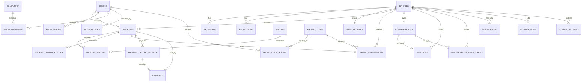

# Database Schema

## 1. Conventions

- Database: Supabase PostgreSQL
- ORM/migrations: Drizzle ORM + versioned SQL migrations
- Auth tables: Better Auth Drizzle adapter เป็นผู้กำหนด shape หลัก ห้ามแก้ด้วยมือโดยไม่ regenerate/migrate
- Business table/column: `snake_case`, ชื่อ table เป็นพหูพจน์
- Business primary key: `uuid` สร้างฝั่ง database; Better Auth user ID ใช้ `text`
- เวลา: `timestamptz` เก็บ UTC; UI แสดง `Asia/Bangkok`
- เงิน: `numeric(12,2)` และ `currency char(3) DEFAULT 'THB'`
- Soft delete/archive: `deleted_at timestamptz`; ห้าม hard delete record ที่ถูกอ้างโดยประวัติ
- Range: ช่วง Booking ใช้ `[starts_at, ends_at)`
- Metadata: `jsonb` ใช้เมื่อโครงสร้างยืดหยุ่นจริง ห้ามใช้แทน column ที่ต้อง constraint/query บ่อย

## 2. Entity Relationship Diagram



`BA_USER`, `BA_SESSION` และ `BA_ACCOUNT` ใน ERD หมายถึง physical tables `user`, `session`, `account` ของ Better Auth

## 3. Enums

| Enum | Values |
| --- | --- |
| `room_type` | `REHEARSAL`, `RECORDING` |
| `room_status` | `AVAILABLE`, `UNAVAILABLE`, `MAINTENANCE` |
| `room_block_type` | `UNAVAILABLE`, `MAINTENANCE` |
| `addon_pricing_type` | `FIXED`, `PER_HOUR`, `PER_UNIT` |
| `booking_status` | `PENDING_PAYMENT`, `CONFIRMED`, `COMPLETED`, `CANCELLED`, `EXPIRED` |
| `booking_actor_type` | `USER`, `ADMIN`, `SYSTEM` |
| `discount_type` | `PERCENTAGE`, `FIXED` |
| `promo_redemption_status` | `RESERVED`, `APPLIED`, `RELEASED` |
| `payment_status` | `PENDING`, `PAID`, `FAILED`, `REFUND_PENDING`, `REFUNDED` |
| `upload_intent_status` | `CREATED`, `CONFIRMED`, `EXPIRED` |
| `conversation_status` | `OPEN`, `CLOSED` |
| `notification_type` | `BOOKING`, `PAYMENT`, `CHAT`, `SYSTEM` |
| `activity_actor_type` | `USER`, `ADMIN`, `SYSTEM` |

Enum เปลี่ยนยากกว่า lookup table จึงใช้เฉพาะค่าที่เป็น workflow contract ส่วน action string และ setting key ใช้ text เพื่อเพิ่มได้โดยไม่ต้อง migration enum ทุกครั้ง

## 4. Better Auth and User Tables

### `user`

Better Auth core + Admin plugin:

| Column | Type | Constraints/notes |
| --- | --- | --- |
| `id` | `text` | PK; Better Auth generated ID |
| `name` | `text` | NOT NULL; display name |
| `email` | `text` | NOT NULL, UNIQUE ตาม Better Auth normalization |
| `email_verified` | `boolean` | NOT NULL DEFAULT false |
| `image` | `text` | nullable |
| `role` | `text` | DEFAULT `user`; Admin plugin |
| `banned` | `boolean` | nullable/default false; Admin plugin field แม้ MVP ไม่ expose UI |
| `ban_reason` | `text` | nullable |
| `ban_expires` | `timestamptz` | nullable |
| `created_at` | `timestamptz` | NOT NULL |
| `updated_at` | `timestamptz` | NOT NULL |

ชื่อ column จริงต้องตรง schema ที่ Better Auth CLI generate และ mapping ของ Drizzle adapter หาก library version เปลี่ยนให้ migration ที่ generate เป็น source of truth

### `session`

Better Auth core columns: `id`, `token` (unique), `user_id` FK, `expires_at`, `ip_address`, `user_agent`, `created_at`, `updated_at` และ `impersonated_by` จาก Admin plugin แม้ MVP ปิด impersonation

Indexes:

- unique `token`
- `(user_id, expires_at)`
- `expires_at` สำหรับ cleanup

### `account`

Better Auth core columns สำหรับ credential/provider linkage: `id`, `account_id`, `provider_id`, `user_id`, token fields, expiry fields, scope, credential password hash และ timestamps

Constraints/indexes:

- unique `(provider_id, account_id)`
- index `user_id`
- Token/password columns เป็น sensitive data ห้าม expose หรือ audit

### `verification`

Better Auth core columns: `id`, `identifier`, `value`, `expires_at`, `created_at`, `updated_at` พร้อม index `(identifier, expires_at)`

### `user_profiles`

| Column | Type | Constraints/notes |
| --- | --- | --- |
| `user_id` | `text` | PK, FK `user.id` ON DELETE CASCADE |
| `first_name` | `varchar(100)` | NOT NULL |
| `last_name` | `varchar(100)` | NOT NULL |
| `phone` | `varchar(32)` | NOT NULL; normalized E.164 เมื่อเป็นไปได้ |
| `created_at` | `timestamptz` | NOT NULL DEFAULT now() |
| `updated_at` | `timestamptz` | NOT NULL DEFAULT now() |

Registration use case ต้องสร้าง Better Auth user และ Profile ให้ครบก่อนตอบสำเร็จ Display name ใน `user.name` derive จากชื่อ/นามสกุล

## 5. Room and Catalog Tables

### `rooms`

| Column | Type | Constraints/notes |
| --- | --- | --- |
| `id` | `uuid` | PK DEFAULT gen_random_uuid() |
| `slug` | `citext` | NOT NULL UNIQUE |
| `name` | `varchar(160)` | NOT NULL |
| `type` | `room_type` | NOT NULL |
| `description` | `text` | NOT NULL DEFAULT '' |
| `capacity` | `integer` | NOT NULL CHECK > 0 |
| `hourly_rate` | `numeric(12,2)` | NOT NULL CHECK > 0 |
| `currency` | `char(3)` | NOT NULL DEFAULT `THB` |
| `status` | `room_status` | NOT NULL DEFAULT `AVAILABLE` |
| `is_published` | `boolean` | NOT NULL DEFAULT false |
| `created_by` | `text` | FK `user.id` |
| `updated_by` | `text` | FK `user.id` |
| `created_at` | `timestamptz` | NOT NULL DEFAULT now() |
| `updated_at` | `timestamptz` | NOT NULL DEFAULT now() |
| `deleted_at` | `timestamptz` | nullable |

Indexes:

- unique `lower(slug)` หรือ `citext UNIQUE`
- partial `(status, name)` WHERE `deleted_at IS NULL AND is_published`
- `deleted_at`

### `room_images`

| Column | Type | Constraints/notes |
| --- | --- | --- |
| `id` | `uuid` | PK |
| `room_id` | `uuid` | FK `rooms.id` ON DELETE CASCADE |
| `storage_path` | `text` | NOT NULL UNIQUE |
| `alt_text` | `varchar(255)` | NOT NULL |
| `sort_order` | `integer` | NOT NULL DEFAULT 0 CHECK >= 0 |
| `created_at` | `timestamptz` | NOT NULL DEFAULT now() |

Index `(room_id, sort_order, id)`

### `equipment`

| Column | Type | Constraints/notes |
| --- | --- | --- |
| `id` | `uuid` | PK |
| `name` | `varchar(160)` | NOT NULL |
| `category` | `equipment_category` | NOT NULL DEFAULT `OTHER`; Amp, Guitar, Bass, Mic, Mixer, Keyboard, Drum หรือ Other |
| `description` | `text` | NOT NULL DEFAULT '' |
| `created_by`, `updated_by` | `text` | FK `user.id` |
| `created_at`, `updated_at` | `timestamptz` | NOT NULL |
| `deleted_at` | `timestamptz` | nullable |

Partial unique `lower(name)` WHERE `deleted_at IS NULL`

### `room_equipment`

| Column | Type | Constraints/notes |
| --- | --- | --- |
| `room_id` | `uuid` | FK `rooms.id` ON DELETE CASCADE |
| `equipment_id` | `uuid` | FK `equipment.id` RESTRICT |
| `quantity` | `integer` | NOT NULL CHECK > 0 |
| `note` | `text` | nullable |
| `updated_by` | `text` | FK `user.id` |
| `updated_at` | `timestamptz` | NOT NULL |

Composite PK `(room_id, equipment_id)`

### `room_blocks`

| Column | Type | Constraints/notes |
| --- | --- | --- |
| `id` | `uuid` | PK |
| `room_id` | `uuid` | FK `rooms.id` RESTRICT |
| `type` | `room_block_type` | NOT NULL |
| `starts_at` | `timestamptz` | NOT NULL |
| `ends_at` | `timestamptz` | NOT NULL CHECK `ends_at > starts_at` |
| `reason` | `text` | NOT NULL |
| `created_by` | `text` | FK `user.id` |
| `created_at` | `timestamptz` | NOT NULL DEFAULT now() |

Index GiST `(room_id, tstzrange(starts_at, ends_at, '[)'))` และ B-tree `(room_id, starts_at)`

### `addons`

| Column | Type | Constraints/notes |
| --- | --- | --- |
| `id` | `uuid` | PK |
| `name` | `varchar(160)` | NOT NULL |
| `description` | `text` | NOT NULL DEFAULT '' |
| `pricing_type` | `addon_pricing_type` | NOT NULL |
| `unit_price` | `numeric(12,2)` | NOT NULL CHECK > 0 |
| `currency` | `char(3)` | NOT NULL DEFAULT `THB` |
| `is_active` | `boolean` | NOT NULL DEFAULT true |
| `created_by`, `updated_by` | `text` | FK `user.id` |
| `created_at`, `updated_at` | `timestamptz` | NOT NULL |
| `deleted_at` | `timestamptz` | nullable |

Partial unique `lower(name)` WHERE `deleted_at IS NULL`

## 6. Booking Tables

### `bookings`

| Column | Type | Constraints/notes |
| --- | --- | --- |
| `id` | `uuid` | PK |
| `booking_number` | `varchar(32)` | NOT NULL UNIQUE; human-readable, ไม่ใช้เป็น PK |
| `user_id` | `text` | FK `user.id` RESTRICT |
| `room_id` | `uuid` | FK `rooms.id` RESTRICT |
| `starts_at` | `timestamptz` | NOT NULL |
| `ends_at` | `timestamptz` | NOT NULL CHECK `ends_at > starts_at` |
| `duration_minutes` | `integer` | NOT NULL CHECK >= 60 AND `% 30 = 0` |
| `status` | `booking_status` | NOT NULL DEFAULT `PENDING_PAYMENT` |
| `room_name_snapshot` | `varchar(160)` | NOT NULL |
| `room_rate_snapshot` | `numeric(12,2)` | NOT NULL CHECK > 0 |
| `room_subtotal` | `numeric(12,2)` | NOT NULL CHECK >= 0 |
| `addon_subtotal` | `numeric(12,2)` | NOT NULL CHECK >= 0 |
| `subtotal` | `numeric(12,2)` | NOT NULL CHECK >= 0 |
| `discount_amount` | `numeric(12,2)` | NOT NULL DEFAULT 0 CHECK >= 0 |
| `total_amount` | `numeric(12,2)` | NOT NULL CHECK >= 0 |
| `currency` | `char(3)` | NOT NULL DEFAULT `THB` |
| `promo_code_snapshot` | `varchar(64)` | nullable |
| `promo_type_snapshot` | `discount_type` | nullable |
| `promo_value_snapshot` | `numeric(12,2)` | nullable |
| `payment_due_at` | `timestamptz` | nullable เฉพาะ Booking ที่ยอดสุทธิ 0 และ Confirm ตั้งแต่สร้าง |
| `confirmed_at` | `timestamptz` | nullable |
| `completed_at` | `timestamptz` | nullable |
| `cancelled_at` | `timestamptz` | nullable |
| `cancelled_by` | `text` | nullable; Better Auth user ID |
| `cancellation_reason` | `text` | nullable |
| `idempotency_key` | `varchar(128)` | NOT NULL |
| `idempotency_payload_hash` | `char(64)` | NOT NULL; ตรวจ key เดิม/payload ต่าง |
| `created_at`, `updated_at` | `timestamptz` | NOT NULL |

Checks:

- `duration_minutes = extract(epoch FROM (ends_at - starts_at)) / 60`
- `subtotal = room_subtotal + addon_subtotal`
- `discount_amount <= subtotal`
- `total_amount = subtotal - discount_amount`
- `total_amount > 0` เมื่อ status เป็น `PENDING_PAYMENT`
- snapshot Promo columns เป็น all-null หรือ all-present ตามประเภท
- unique `(user_id, idempotency_key)`

Indexes:

- `(user_id, created_at DESC, id)` สำหรับ Booking history
- `(room_id, starts_at, ends_at)` สำหรับ calendar/availability
- `(status, payment_due_at)` สำหรับ expiry job
- `(status, starts_at)` สำหรับ operations/dashboard
- trigram/normalized index ที่ `booking_number` หาก search pattern ต้องการ

### Active Booking exclusion constraint

```sql
CREATE EXTENSION IF NOT EXISTS btree_gist;

ALTER TABLE bookings
ADD CONSTRAINT bookings_no_active_overlap
EXCLUDE USING gist (
  room_id WITH =,
  tstzrange(starts_at, ends_at, '[)') WITH &&
)
WHERE (status IN ('PENDING_PAYMENT', 'CONFIRMED'));
```

Migration ต้องทดสอบ SQL นี้กับ enum/column จริง และ API map exclusion violation เป็น `BOOKING_CONFLICT`

### `booking_addons`

| Column | Type | Constraints/notes |
| --- | --- | --- |
| `id` | `uuid` | PK |
| `booking_id` | `uuid` | FK `bookings.id` ON DELETE RESTRICT |
| `addon_id` | `uuid` | FK `addons.id` RESTRICT |
| `name_snapshot` | `varchar(160)` | NOT NULL |
| `pricing_type_snapshot` | `addon_pricing_type` | NOT NULL |
| `unit_price_snapshot` | `numeric(12,2)` | NOT NULL CHECK > 0 |
| `quantity` | `integer` | NOT NULL CHECK > 0 |
| `line_total` | `numeric(12,2)` | NOT NULL CHECK >= 0 |
| `created_at` | `timestamptz` | NOT NULL |

Unique `(booking_id, addon_id)` และ index `booking_id`

### `booking_status_history`

| Column | Type | Constraints/notes |
| --- | --- | --- |
| `id` | `uuid` | PK |
| `booking_id` | `uuid` | FK `bookings.id` ON DELETE RESTRICT |
| `from_status` | `booking_status` | nullable เฉพาะ creation |
| `to_status` | `booking_status` | NOT NULL |
| `actor_type` | `booking_actor_type` | NOT NULL |
| `actor_user_id` | `text` | nullable สำหรับ SYSTEM; FK `user.id` RESTRICT |
| `reason` | `text` | nullable/required ตาม transition |
| `created_at` | `timestamptz` | NOT NULL DEFAULT now() |

Index `(booking_id, created_at, id)`

## 7. Promo Tables

### `promo_codes`

| Column | Type | Constraints/notes |
| --- | --- | --- |
| `id` | `uuid` | PK |
| `code` | `citext` | NOT NULL UNIQUE; application trim + uppercase |
| `description` | `text` | NOT NULL DEFAULT '' |
| `discount_type` | `discount_type` | NOT NULL |
| `discount_value` | `numeric(12,2)` | NOT NULL CHECK > 0; percentage CHECK <= 100 |
| `max_discount_amount` | `numeric(12,2)` | nullable CHECK > 0 |
| `min_booking_amount` | `numeric(12,2)` | NOT NULL DEFAULT 0 CHECK >= 0 |
| `starts_at` | `timestamptz` | NOT NULL |
| `ends_at` | `timestamptz` | nullable CHECK null OR > starts_at |
| `total_usage_limit` | `integer` | nullable CHECK > 0 |
| `per_user_limit` | `integer` | nullable CHECK > 0 |
| `applies_to_all_rooms` | `boolean` | NOT NULL DEFAULT true |
| `is_active` | `boolean` | NOT NULL DEFAULT true |
| `created_by`, `updated_by` | `text` | FK `user.id` |
| `created_at`, `updated_at` | `timestamptz` | NOT NULL |
| `deleted_at` | `timestamptz` | nullable |

Indexes `(is_active, starts_at, ends_at)` และ partial unique `lower(code)` WHERE `deleted_at IS NULL` หากไม่ใช้ `citext` unique

### `promo_code_rooms`

| Column | Type | Constraints/notes |
| --- | --- | --- |
| `promo_code_id` | `uuid` | FK `promo_codes.id` ON DELETE CASCADE |
| `room_id` | `uuid` | FK `rooms.id` ON DELETE RESTRICT |

Composite PK `(promo_code_id, room_id)`

### `promo_redemptions`

| Column | Type | Constraints/notes |
| --- | --- | --- |
| `id` | `uuid` | PK |
| `promo_code_id` | `uuid` | FK `promo_codes.id` RESTRICT |
| `booking_id` | `uuid` | FK `bookings.id` RESTRICT, UNIQUE |
| `user_id` | `text` | FK `user.id` RESTRICT |
| `status` | `promo_redemption_status` | NOT NULL DEFAULT `RESERVED` |
| `discount_amount` | `numeric(12,2)` | NOT NULL CHECK >= 0 |
| `reserved_at` | `timestamptz` | NOT NULL |
| `applied_at` | `timestamptz` | nullable |
| `released_at` | `timestamptz` | nullable |

Indexes:

- `(promo_code_id, status)` สำหรับ total usage
- `(promo_code_id, user_id, status)` สำหรับ per-user usage
- unique `booking_id`

Quota enforcement ต้อง lock `promo_codes` row แล้วนับ `RESERVED` + `APPLIED` ใน transaction ไม่มี aggregate CHECK constraint ที่ทำหน้าที่นี้ได้อย่างปลอดภัย

## 8. Payment Tables

### `payment_upload_intents`

| Column | Type | Constraints/notes |
| --- | --- | --- |
| `id` | `uuid` | PK |
| `booking_id` | `uuid` | FK `bookings.id` RESTRICT |
| `user_id` | `text` | FK `user.id` RESTRICT |
| `storage_path` | `text` | NOT NULL UNIQUE |
| `expected_mime_type` | `varchar(100)` | NOT NULL |
| `max_bytes` | `integer` | NOT NULL DEFAULT 10485760 |
| `status` | `upload_intent_status` | NOT NULL DEFAULT `CREATED` |
| `expires_at` | `timestamptz` | NOT NULL |
| `created_at` | `timestamptz` | NOT NULL DEFAULT now() |
| `confirmed_at` | `timestamptz` | nullable |

Indexes `(status, expires_at)` สำหรับ cleanup และ `(booking_id, created_at DESC)`

### `payments`

| Column | Type | Constraints/notes |
| --- | --- | --- |
| `id` | `uuid` | PK |
| `booking_id` | `uuid` | FK `bookings.id` RESTRICT |
| `upload_intent_id` | `uuid` | FK `payment_upload_intents.id` RESTRICT, UNIQUE |
| `attempt_number` | `integer` | NOT NULL CHECK > 0 |
| `amount` | `numeric(12,2)` | NOT NULL CHECK > 0 |
| `currency` | `char(3)` | NOT NULL DEFAULT `THB` |
| `status` | `payment_status` | NOT NULL DEFAULT `PENDING` |
| `slip_storage_path` | `text` | NOT NULL UNIQUE |
| `slip_sha256` | `char(64)` | NOT NULL UNIQUE; ป้องกันไฟล์เดิมถูกใช้ซ้ำ |
| `submitted_at` | `timestamptz` | NOT NULL |
| `reviewed_by` | `text` | nullable FK `user.id` RESTRICT |
| `reviewed_at` | `timestamptz` | nullable |
| `review_note` | `text` | nullable |
| `transfer_occurred_at` | `timestamptz` | nullable; Admin-confirmed metadata |
| `refund_amount` | `numeric(12,2)` | nullable CHECK > 0 |
| `refund_reference` | `varchar(255)` | nullable |
| `refunded_at` | `timestamptz` | nullable |
| `created_at`, `updated_at` | `timestamptz` | NOT NULL |

Constraints/indexes:

- unique `(booking_id, attempt_number)`
- partial unique `booking_id` WHERE status IN (`PAID`, `REFUND_PENDING`, `REFUNDED`) เพื่อมี settled lifecycle เดียว
- `(status, submitted_at)` สำหรับ Admin review queue
- `(booking_id, created_at DESC)`
- refund fields ต้อง present เมื่อสถานะ `REFUNDED`
- `refund_amount <= amount`
- Service บังคับ `amount = bookings.total_amount` เพราะ CHECK constraint อ้างข้าม table ไม่ได้

## 9. Chat Tables

### `conversations`

| Column | Type | Constraints/notes |
| --- | --- | --- |
| `id` | `uuid` | PK |
| `customer_id` | `text` | FK `user.id` RESTRICT, UNIQUE สำหรับหนึ่ง support thread/User |
| `status` | `conversation_status` | NOT NULL DEFAULT `OPEN` |
| `last_message_at` | `timestamptz` | nullable |
| `created_at`, `updated_at` | `timestamptz` | NOT NULL |

Indexes `(status, last_message_at DESC)` และ unique `customer_id`

### `messages`

| Column | Type | Constraints/notes |
| --- | --- | --- |
| `id` | `uuid` | PK; UUIDv7 เหมาะกับ ordering |
| `conversation_id` | `uuid` | FK `conversations.id` RESTRICT |
| `sender_user_id` | `text` | FK `user.id` RESTRICT |
| `body` | `varchar(2000)` | NOT NULL CHECK length(trim(body)) > 0 |
| `created_at` | `timestamptz` | NOT NULL DEFAULT now() |

Index `(conversation_id, created_at DESC, id DESC)` สำหรับ cursor pagination

### `conversation_read_states`

| Column | Type | Constraints/notes |
| --- | --- | --- |
| `conversation_id` | `uuid` | FK `conversations.id` ON DELETE CASCADE |
| `user_id` | `text` | FK `user.id` ON DELETE CASCADE |
| `last_read_message_id` | `uuid` | nullable FK `messages.id` RESTRICT |
| `last_read_at` | `timestamptz` | NOT NULL DEFAULT now() |

Composite PK `(conversation_id, user_id)`; service ต้องป้องกัน cursor ถอยหลัง

## 10. Notification and Audit Tables

### `notifications`

| Column | Type | Constraints/notes |
| --- | --- | --- |
| `id` | `uuid` | PK; UUIDv7 เหมาะกับ ordering |
| `user_id` | `text` | FK `user.id` RESTRICT |
| `type` | `notification_type` | NOT NULL |
| `title` | `varchar(200)` | NOT NULL |
| `body` | `text` | NOT NULL |
| `data` | `jsonb` | NOT NULL DEFAULT `{}`; ID/navigation metadata ที่ไม่ sensitive |
| `read_at` | `timestamptz` | nullable |
| `created_at` | `timestamptz` | NOT NULL DEFAULT now() |

Indexes:

- `(user_id, created_at DESC, id DESC)`
- partial `(user_id, created_at DESC)` WHERE `read_at IS NULL`

### `activity_logs`

| Column | Type | Constraints/notes |
| --- | --- | --- |
| `id` | `uuid` | PK; UUIDv7 |
| `actor_type` | `activity_actor_type` | NOT NULL |
| `actor_user_id` | `text` | nullable FK `user.id` RESTRICT |
| `action` | `varchar(120)` | NOT NULL; เช่น `booking.created` |
| `entity_type` | `varchar(80)` | NOT NULL |
| `entity_id` | `text` | NOT NULL; polymorphic, ไม่มี FK |
| `before_data` | `jsonb` | nullable; changed fields ที่ redact แล้ว |
| `after_data` | `jsonb` | nullable; changed fields ที่ redact แล้ว |
| `metadata` | `jsonb` | NOT NULL DEFAULT `{}`; safe context only |
| `request_id` | `uuid` | nullable สำหรับ background/migration events |
| `ip_address` | `inet` | nullable |
| `user_agent` | `text` | nullable |
| `created_at` | `timestamptz` | NOT NULL DEFAULT now() |

Indexes:

- `(actor_user_id, created_at DESC)`
- `(entity_type, entity_id, created_at DESC)`
- `(action, created_at DESC)`
- `(created_at DESC)` สำหรับ retention/export

ไม่มี `updated_at`/`deleted_at` และ application ไม่มี UPDATE/DELETE permission

## 11. Settings

### `system_settings`

| Column | Type | Constraints/notes |
| --- | --- | --- |
| `key` | `varchar(100)` | PK |
| `value` | `jsonb` | NOT NULL |
| `version` | `integer` | NOT NULL DEFAULT 1 CHECK > 0 |
| `updated_by` | `text` | FK `user.id` RESTRICT |
| `updated_at` | `timestamptz` | NOT NULL DEFAULT now() |

Initial records:

| Key | Value |
| --- | --- |
| `booking.policy` | `{"timezone":"Asia/Bangkok","currency":"THB","open24Hours":true,"minimumMinutes":60,"incrementMinutes":30,"cancellationCutoffHours":12,"paymentDueMinutes":30}` |
| `payment.upload` | `{"allowedMimeTypes":["image/jpeg","image/png","application/pdf"],"maxBytes":10485760,"signedDownloadSeconds":300}` |

Application ต้อง validate JSON ด้วย versioned schema ก่อนใช้/อัปเดตและบันทึก Activity Log ทุกครั้ง

## 12. Derived Data and Reports

MVP ไม่สร้าง aggregate table ข้อมูลต่อไปนี้ derive จาก source tables:

- Gross received: `payments` สถานะ `PAID`, `REFUND_PENDING`, `REFUNDED`; Net received หัก `refund_amount` ของ `REFUNDED` ตามเวลาคืน
- Booking count/status: `bookings`
- Usage hours/popular room: `bookings` สถานะ `CONFIRMED`, `COMPLETED`
- Unread notifications: `notifications.read_at IS NULL`
- Unread chat: `messages` หลัง `conversation_read_states` cursor และ sender ไม่ใช่ reader

เพิ่ม materialized view/rollup ได้เมื่อ query metrics แสดงว่าจำเป็น พร้อม refresh strategy และ reconciliation test

## 13. Storage Design

### `room-images`

- Visibility: public read และถือว่าทุกรูปใน bucket ไม่ใช่ข้อมูลลับ; API เปิดเผย path เฉพาะห้องที่ publish
- Write/delete: server-side Admin integration เท่านั้น
- Path: `rooms/<roomId>/<uuid>.<ext>`
- DB reference: `room_images.storage_path`
- ห้ามเก็บ full public URL เพื่อให้เปลี่ยน project/CDN ได้

### `payment-slips`

- Visibility: private
- Upload: signed upload URL หลัง session/ownership check
- Download: short-lived signed URL หลัง ownership/Admin check
- Path: `bookings/<bookingId>/payments/<paymentIntentId>/<uuid>.<ext>`
- `upsert = false`
- Orphan object cleanup อ้างอิง `payment_upload_intents`

## 14. Realtime Authorization Model

Realtime ใช้ custom short-lived JWT เพราะ identity หลักมาจาก Better Auth

Claims ขั้นต่ำ:

```json
{
  "iss": "configured-issuer",
  "sub": "better-auth-user-id",
  "aud": "authenticated",
  "role": "authenticated",
  "app_role": "user",
  "iat": 0,
  "exp": 0
}
```

- `app_role` เป็น `user` หรือ `admin`
- JWT signed ด้วย asymmetric private key ที่ server ถือและมี `kid` ตรงกับ key ที่ Supabase trust
- Client ใช้ `accessToken` callback และ channel `private: true`
- ปิด public channel access

Conceptual receive policies บน `realtime.messages`:

```sql
-- User เจ้าของ conversation หรือ Admin รับ conversation event ได้
EXISTS (
  SELECT 1
  FROM conversations c
  WHERE 'conversation:' || c.id::text = realtime.topic()
    AND (
      c.customer_id = current_setting('request.jwt.claims', true)::jsonb ->> 'sub'
      OR current_setting('request.jwt.claims', true)::jsonb ->> 'app_role' = 'admin'
    )
)

-- User รับ notification topic ของตัวเอง
realtime.topic() = 'user:' ||
  (current_setting('request.jwt.claims', true)::jsonb ->> 'sub')

-- Admin operations topic
realtime.topic() = 'admin:operations'
AND current_setting('request.jwt.claims', true)::jsonb ->> 'app_role' = 'admin'
```

Migration จริงต้องสร้าง policy แยก `FOR SELECT` สำหรับ receive, จำกัด `extension = 'broadcast'` และทดสอบทั้ง allow/deny Server เป็นผู้ broadcast หลัง commit; Browser ไม่มีสิทธิ์ใช้ Broadcast แทน Chat API

## 15. Delete and Retention Policy

| Data | Policy |
| --- | --- |
| Room/Equipment/Add-on/Promo | Soft delete/archive เมื่อมี reference |
| Booking/Payment/Status history | ไม่ hard delete ผ่าน application |
| Chat messages | ไม่แก้/ลบผ่าน MVP UI; retention ต้องเป็นนโยบายแยก |
| Payment slips | เก็บตามนโยบายบัญชี/ความเป็นส่วนตัวของธุรกิจ; การลบต้องคง Payment/Audit metadata |
| Activity logs | Append-only; archive ตาม production retention policy |
| Better Auth verification/session | Cleanup ตาม expiry และ Better Auth guidance |
| Orphan uploads | Scheduled cleanup หลัง intent หมดอายุ |

## 16. Migration Rules

1. Generate/review Better Auth schema เมื่อเปลี่ยน Better Auth/plugin version
2. Drizzle migration ต้อง commit พร้อม schema change
3. ทดสอบ migration บน staging snapshot ก่อน production
4. Constraint/index ที่ Drizzle DSL รองรับไม่ครบให้เขียน reviewed SQL migration
5. Breaking migration ใช้ expand -> backfill -> switch -> contract
6. ห้ามลบ column/table ใน deployment เดียวกับ code ที่เพิ่งหยุดใช้
7. Seed เฉพาะค่าตั้งต้นและ development fixtures ห้ามใส่ production secret/ข้อมูลส่วนบุคคล

## 17. Required Database Tests

- Insert Active Booking ทับกันใน concurrent transactions: สำเร็จหนึ่งรายการเท่านั้น
- Booking ต่อกันที่ boundary เดียวกัน: สำเร็จทั้งคู่
- Room Block overlap ถูก service ปฏิเสธ
- Promo total/per-user quota ภายใต้ concurrent requests
- Payment มี settled lifecycle ได้หนึ่งรายการต่อ Booking
- Status history/Audit/Notification rollback พร้อม business write เมื่อ transaction ล้ม
- `activity_logs` update/delete ถูกปฏิเสธสำหรับ application role
- Realtime RLS อนุญาตเจ้าของ/Admin และปฏิเสธ User อื่น
- Signed upload intent หมดอายุหรือ object metadata ไม่ตรงถูกปฏิเสธ
